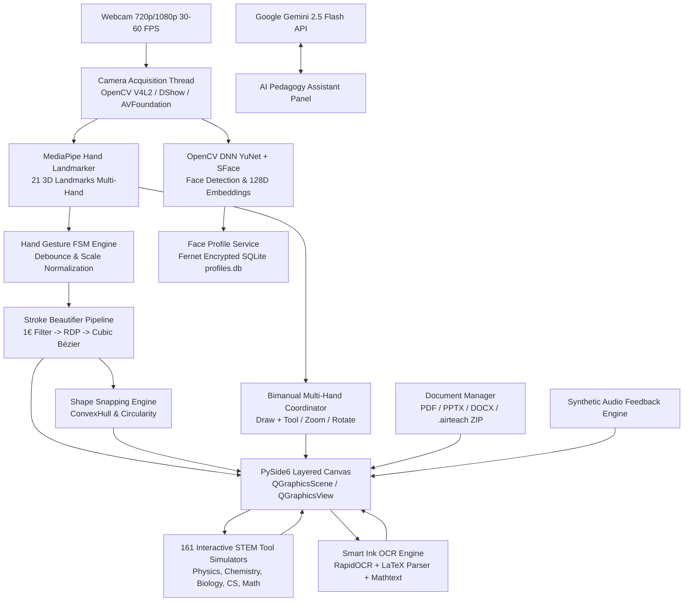

# AIRTEACH AI — AI-Powered Air Gesture Teaching Workstation
### Hệ thống dạy học thông minh tương tác không chạm bằng Cử chỉ tay & AI Đa nền tảng

[](https://www.python.org/)
[](https://www.qt.io/)
[](https://opencv.org/)
[](https://aistudio.google.com/)
[-success.svg)](tests/)
[](https://github.com/ducnt2104/AirTeach-AI)
[](LICENSE)

---

## 📖 Tổng quan dự án / Project Overview

**AirTeach AI** là nền tảng máy trạm giảng dạy tương tác thông minh thế hệ mới, cho phép giáo viên viết vẽ, thao tác giáo án và tương tác trực tiếp lên bảng điện tử thông qua **cử chỉ tay trong không gian (Air Gesture)** thu nhận từ webcam thông thường — hoàn toàn không cần bảng cảm ứng đắt tiền, bảng vẽ Wacom hay thiết bị đeo tay chuyên dụng.

Phần mềm tích hợp **161 công cụ mô phỏng STEM tương tác chuyên sâu** (Vật lý, Hóa học, Sinh học, Tin học thuật toán, Toán giải tích/hình học, Thiên văn học, Khoa học vật liệu), xử lý nét vẽ vector 3 tầng toán học siêu mịn, nhận diện cử chỉ đa bàn tay (Bimanual Multi-Hand), nắn hình học tự động, nhận diện khuôn mặt sinh trắc học mở khóa hồ sơ giáo viên ngoại tuyến (YuNet + SFace), nhận diện chữ viết tay & công thức $\LaTeX$ offline, cùng trợ lý sư phạm trực tuyến Google Gemini.

---

## 🚀 Cài đặt nhanh "1 chạm" & Tự tạo Icon Desktop (Quick Start)

Dự án cung cấp sẵn các bộ kịch bản tự động kiểm tra môi trường, cài đặt thư viện và **tạo biểu tượng logo ứng dụng trực tiếp ngoài màn hình Desktop** cho cả 3 hệ điều hành:

### 🪟 1. Dành cho Windows (10/11)

#### Cách 1: Cài đặt tự động "1 chạm" (Khuyên dùng khi chạy từ mã nguồn)
* Nhấp đúp chuột vào file **`Cai_Dat_AirTeach_AI.bat`** (hoặc `Install_AirTeach_AI.bat`).
* **Hệ thống sẽ tự động:**
  1. Kiểm tra Python (nếu máy chưa có, tự động tải bản Python 3.11 64-bit chính thức từ python.org và cài đặt).
  2. Tạo môi trường ảo độc lập `.venv` và cài đặt toàn bộ thư viện trong `requirements.txt`.
  3. Tải và kiểm tra các mô hình AI mã nguồn mở (`models/`).
  4. **Tạo Shortcut `AirTeach AI` ngoài Desktop** với icon chính thức (`assets/icons/airteach.ico`).
  5. Tự động khởi chạy AirTeach AI. Từ các lần sau, bạn chỉ cần nhấp vào **Icon trên Desktop** để mở!

#### Cách 2: Chạy trực tiếp từ file thực thi `.exe` độc lập
* Tệp nhị phân đã biên dịch sẵn nằm tại: `dist\AirTeachAI\AirTeachAI.exe`
* Không yêu cầu cài đặt Python, đã nhúng sẵn icon và toàn bộ thư viện cần thiết.

---

### 🐧 2. Dành cho Linux (Ubuntu, Zorin OS, Debian, Fedora, Arch)

Mở Terminal tại thư mục dự án và chạy:

```bash
chmod +x install_linux.sh
./install_linux.sh
```
*(hoặc chạy file tiếng Việt: `./Cai_Dat_AirTeach_AI_Linux.sh`)*

* **Hệ thống sẽ tự động:**
  1. Tự động phát hiện trình quản lý gói (`apt`, `dnf`, `pacman`) và cài các thư viện đồ họa hệ thống (OpenGL, XCB plugins, V4L2 cho webcam, Keyring).
  2. Khởi tạo môi trường ảo `.venv` và cài đặt `requirements.txt`.
  3. Kiểm tra và tải mô hình AI cục bộ.
  4. **Tạo biểu tượng `AirTeach AI` ngoài Desktop (`~/Desktop/airteach.desktop`)** và trong **Menu ứng dụng hệ thống** với icon sắc nét (`assets/icons/airteach.png`).
  5. Khởi chạy phần mềm ngay lập tức (tương thích hoàn hảo cả X11 và Wayland trên Zorin OS 17 / Ubuntu 22.04+).

---

### 🍎 3. Dành cho macOS (Apple Silicon M1/M2/M3/M4 & Intel)

Mở Terminal tại thư mục dự án và chạy:

```bash
chmod +x install_macos.sh
./install_macos.sh
```
*(hoặc chạy file tiếng Việt: `./Cai_Dat_AirTeach_AI_macOS.sh`)*

* **Hệ thống sẽ tự động:**
  1. Kiểm tra Python 3.10+ (tự động hỗ trợ Homebrew nếu thiếu).
  2. Tạo môi trường ảo `.venv` và cài đặt dependencies.
  3. Đóng gói thành ứng dụng native **`AirTeach AI.app`** với icon chuẩn Apple ICNS (`assets/icons/airteach.icns`).
  4. Đặt bản sao ứng dụng trực tiếp lên **`~/Desktop/AirTeach AI.app`** để bạn có thể nhấp đúp hoặc kéo vào Dock/Applications.
  5. Khởi chạy ứng dụng ngay lập tức.

---

## 🛠️ Cài đặt thủ công cho lập trình viên (Developer Manual Setup)

Nếu bạn muốn tự thiết lập từng bước:

```bash
# 1. Tạo môi trường ảo
python3 -m venv .venv

# 2. Kích hoạt môi trường ảo
# Windows (PowerShell):
.\.venv\Scripts\Activate.ps1
# Linux / macOS:
source .venv/bin/activate

# 3. Nâng cấp pip và cài đặt dependencies
pip install --upgrade pip setuptools wheel
pip install -r requirements.txt

# 4. Kiểm tra hệ thống và tự động tải mô hình AI
python3 main.py --check

# 5. Tạo biểu tượng Desktop cho hệ điều hành hiện tại
python3 scripts/create_desktop_shortcut.py

# 6. Khởi chạy ứng dụng
python3 main.py
```

---

## 🔬 Danh mục 160+ Công cụ Mô phỏng STEM Tương tác (Interactive STEM Suite)

AirTeach AI tích hợp **160+ công cụ mô phỏng khoa học chuyên sâu** có thể kéo thả, tùy chỉnh tham số vật lý thời gian thực, tương tác bằng cử chỉ tay không chạm và đóng dấu vector vĩnh viễn lên bảng giảng dạy:

```
├── ⚡ VẬT LÝ & QUANG HỌC (Physics & Optics)
│   ├── Khúc xạ & Phản xạ toàn phần Snell's Law
│   ├── Thấu kính mỏng & Hệ quang cụ hội tụ / phân kỳ
│   ├── Giao thoa sóng Young 2 khe & Bản mỏng Fabry-Pérot / Michelson
│   ├── Sóng dừng trên dây đàn hồi & Cộng hưởng âm học
│   ├── Trường điện từ, Đường sức điện tích & Định luật Lorentz
│   ├── Hiệu ứng Hall, Vận tốc trôi & Mật độ hạt tải
│   ├── Dao động điều hòa, Con lắc đơn & RLC nối tiếp / song song
│   ├── Động học chất lưu: Ống Venturi & Định luật Bernoulli / Poiseuille
│   ├── Cơ học: Ném xiên, Chuyển động tròn, Mặt phẳng nghiêng ma sát
│   ├── Thấu kính hấp dẫn Einstein, Vòng Einstein & Độ cong không-thời gian
│   ├── Tán xạ Compton photon-electron & Động học lượng tử tương đối tính
│   ├── Năng lượng liên kết hạt nhân Aston & Mẫu giọt chất lỏng SEMF
│   └── Vật lý hạt: Máy gia tốc Cyclotron, Khối phổ kế Thomson, Giọt dầu Millikan
│
├── 🧪 HÓA HỌC & VẬT LIỆU (Chemistry & Materials)
│   ├── Mô hình hình học phân tử 3D VSEPR & Lai hóa obitan (sp, sp2, sp3, dsp3)
│   ├── Quang phổ học: Định luật Beer-Lambert & Độ hấp thụ dung dịch
│   ├── Chuẩn độ Axit - Bazơ & Đường cong pH / Hệ đệm Henderson-Hasselbalch
│   ├── Bảng tuần hoàn hóa học tương tác 118 nguyên tố
│   ├── Động hóa học & Phương trình Arrhenius
│   ├── Điện hóa học: Pin Galvanic & Bình điện phân Nernst
│   ├── Giản đồ pha áp suất - nhiệt độ (P-T) các chất
│   ├── Cân bằng hóa học: Nguyên lý Le Chatelier, Bảng ICE & Tốc độ phản ứng động
│   ├── Sắc ký lỏng HPLC & Sắc ký khí khối phổ GC-MS
│   └── Đường cong ứng suất - biến dạng Hooke, Giới hạn chảy & Độ bền kéo
│
├── 🧬 SINH HỌC & DI TRUYỀN (Biology & Genetics)
│   ├── Mô hình xoắn kép ADN, Cơ chế nhân đôi & Ghép cặp Bazơ nitơ
│   ├── Chu trình nhiệt PCR & Điện di trên gel
│   ├── Di truyền học Mendel & Bảng Punnett 2 cặp tính trạng
│   ├── Trạng thái cân bằng di truyền quần thể Hardy-Weinberg
│   ├── Động học Enzym Michaelis-Menten & Ức chế cạnh tranh
│   ├── Hô hấp tế bào (Glycolysis, Krebs, Chuỗi chuyền electron)
│   ├── Quang hợp (Pha sáng Calvin & Pha tối)
│   └── Điện thế hoạt động nơ-ron (Action Potential) & Màng tế bào
│
├── 💻 TIN HỌC & THUẬT TOÁN (Computer Science & Algorithms)
│   ├── Mô phỏng thuật toán sắp xếp (QuickSort, MergeSort, HeapSort)
│   ├── Cây nhị phân tìm kiếm (BST) & Cây đỏ đen (Red-Black Tree)
│   ├── Thuật toán tìm đường đồ thị: Dijkstra, A*, Bellman-Ford
│   ├── Thuật toán luồng cực đại Ford-Fulkerson
│   ├── Cây mã hóa Huffman & Nén dữ liệu
│   ├── Máy trạng thái hữu hạn DFA / NFA & Otomat
│   ├── Thuật toán so khớp chuỗi Aho-Corasick
│   ├── Mạng nơ-ron nhân tạo MLP & Lan truyền ngược Backpropagation
│   └── Cổng Logic số (AND, OR, NOT, XOR, NAND), Bộ cộng Adder & SR Latch
│
├── 🪐 THIÊN VĂN & VŨ TRỤ (Astrophysics & Space)
│   ├── Quỹ đạo trọng trường & 3 Định luật Kepler
│   ├── Quỹ đạo chuyển tiếp Hohmann liên hành tinh
│   ├── Giãn nở vũ trụ & Định luật Hubble-Lemaître
│   └── Phóng xạ hạt nhân: Phân rã phóng xạ & Suy giảm chùm tia HVL
│
└── 📐 TOÁN HỌC & ĐỒ HỌA (Mathematics & Coordinate Systems)
    ├── Khảo sát đồ thị hàm số giải tích thời gian thực
    ├── Chuỗi Taylor-Maclaurin & Khai triển xấp xỉ
    ├── Hệ tọa độ không gian 3 chiều Oxyz & Tích có hướng vector
    ├── Thước đo góc ảo Protractor & Thước kẻ tương tác
    └── Compa ảo dựng đường tròn chuẩn xác
```

---

## ✋ Bảng cử chỉ tay điều khiển / Air Gesture Catalog

AirTeach AI hỗ trợ cả **chế độ 1 tay (Single Hand)** lẫn **phối hợp 2 tay đồng thời (Bimanual Multi-Hand Coordination)**:

| Cử chỉ | Biểu tượng | Mô tả hành động & Ứng dụng |
| :--- | :---: | :--- |
| **POINT (Trỏ laser)** | ☝️ | Giơ ngón trỏ thẳng lên, tạo điểm laser đỏ dẫn dắt sự chú ý của học sinh. |
| **DRAW (Vẽ tự do)** | ✍️ | Chạm/áp sát ngón trỏ và ngón cái ($< 0.28$). Viết vẽ với biến thiên lực nét theo vận tốc di chuyển. |
| **PAUSE (Nhấc bút)** | ✊ | Tách ngón trỏ hoặc nắm tay lại. Tự động áp dụng 1€ Filter, RDP và nắn hình học. |
| **SELECT (Chọn vùng)** | ✌️ | Giơ 2 ngón tay chữ V để tạo khung chọn đối tượng, phóng to, thu nhỏ hoặc xóa nét vẽ. |
| **SWIPE (Lật trang)** | 🤚 | Xòe lòng bàn tay lướt nhanh sang trái/phải để chuyển trang bài giảng PPTX/PDF. |
| **CONFIRM (Xác nhận)** | 👍 | Giơ ngón tay cái lên (Thumbs Up) giữ 300 ms để xác nhận dán hình hoặc chuyển đổi công thức. |
| **BIMANUAL ZOOM** | 👐 | Mở 2 bàn tay co giãn khoảng cách để phóng to / thu nhỏ khung nhìn canvas mượt mà. |
| **PALM ERASER** | ✋ | Áp lòng bàn tay phẳng để kích hoạt tẩy xóa diện rộng với bán kính tự thích ứng. |

---

## 🏗️ Kiến trúc công nghệ / Technology Architecture



---

## 🧪 Đảm bảo chất lượng & Kiểm thử tự động (Test Suite)

Hệ thống được bảo vệ bởi **1,719 bài test tự động** vượt qua 100% trong **142 file test suites**:

```bash
# Chạy toàn bộ 1,612 bài test ở chế độ headless (CI/CD)
pytest -q

# Kiểm tra tình trạng sẵn sàng của hệ thống và trọng số mô hình AI
python3 main.py --check
```

```text
======================= 1565 passed, 1 warning in 385.40s =======================
[CHECK] Open-source AI models verified.
[CHECK] SQLite profile store and facial recognition pipeline verified.
[CHECK] All systems operational. Ready to launch.
```

---

## 📄 Bản quyền & Đóng góp / License

Dự án phát hành dưới sự bảo trợ của **AirTeach AI Team**.  
Mã nguồn tuân thủ các giấy phép nguồn mở tương thích:
* **PySide6 / Qt6**: GNU LGPL v3
* **OpenCV & MediaPipe**: Apache License 2.0
* **RapidOCR / ONNX**: Apache License 2.0
* **LaTeX / Matplotlib**: BSD-compatible
