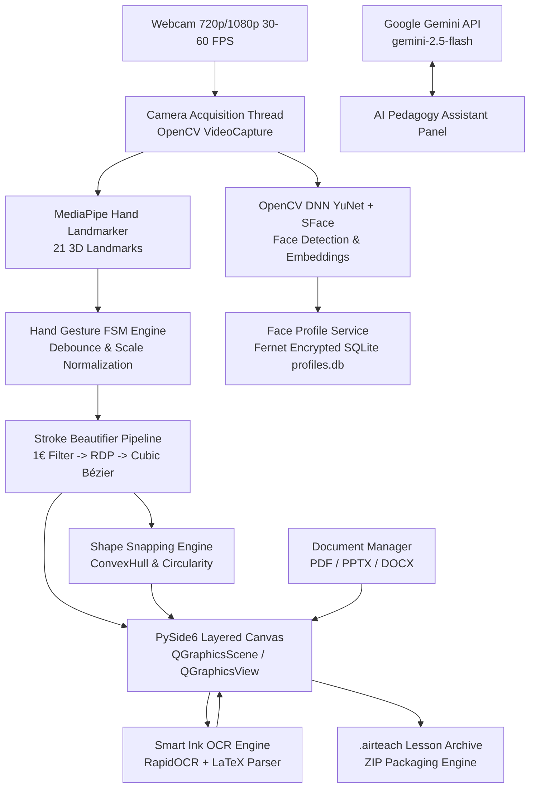

# AIRTECH AI — AI-Powered Air Gesture Teaching Platform
### Hệ thống dạy học thông minh tương tác không chạm bằng AI

[](https://www.python.org/)
[](https://www.qt.io/)
[](https://opencv.org/)
[](https://aistudio.google.com/)
[](tests/)
[](https://microsoft.com/windows)
[](LICENSE)

---

## 📖 Tổng quan dự án / Project Overview

**AirTeach AI** là nền tảng ứng dụng desktop giảng dạy thông minh thế hệ mới, cho phép giáo viên tương tác và viết vẽ trực tiếp lên bảng điện tử thông qua **cử chỉ tay trong không gian (Air Gesture)** thu nhận từ webcam thông thường mà không cần bảng tương tác đắt tiền, bảng vẽ cảm ứng, hay bất kỳ thiết bị đeo tay chuyên dụng nào.

Hệ thống kết hợp kiến trúc **Local-First (ưu tiên xử lý cục bộ)**, thị giác máy tính thời gian thực độ trễ siêu thấp (<25 ms), xử lý làm mịn nét vẽ vector 3 tầng toán học, nắn hình học thông minh, nhận diện khuôn mặt sinh trắc học mở khóa hồ sơ giáo viên, nhận diện chữ viết tay & công thức toán học ngoại tuyến, cùng trợ lý sư phạm trực tuyến Google Gemini.

---

## 🎯 Vấn đề & Giải pháp / Problem & Solution

### Vấn đề thực tế (The Problem)
- **Chi phí thiết bị cao:** Các giải pháp bảng tương tác thông minh (Smart Board, Wacom Display) có giá thành rất cao, khó phổ cập tới mọi lớp học vùng sâu vùng xa hoặc trường học phổ thông.
- **Ràng buộc vị trí:** Giáo viên khi sử dụng máy chiếu hoặc chuột thường bị cố định trước bàn phím/chuột máy tính, làm giảm tính tự nhiên và năng động trong tương tác lớp học.
- **Phụ thuộc kết nối mạng:** Nhiều giải pháp phần mềm giáo dục hiện đại đòi hỏi kết nối Internet liên tục, dễ tê liệt khi đường truyền mạng học đường không ổn định.
- **Chữ viết tay thô cứng:** Viết vẽ bằng cử chỉ qua webcam thường bị rung tay, nét vẽ giật cục, méo mó nếu thiếu bộ lọc toán học thích ứng tốc độ cao.

### Giải pháp của AirTeach AI (The Solution)
- **Tương tác hoàn toàn không chạm:** Chỉ cần webcam tiêu chuẩn (USB hoặc tích hợp sẵn trên laptop), nhận diện chính xác 21 điểm mốc 3D của bàn tay.
- **Nét vẽ vector chuẩn xác và mượt mà:** Bộ xử lý nét vẽ 3 tầng: Bộ lọc thông thấp thích ứng vận tốc **1€ Filter** (Casiez et al., 2012) $\rightarrow$ Rút gọn điểm **Ramer–Douglas–Peucker (RDP)** $\rightarrow$ Nội suy đường cong **Cubic Bézier Spline $C^1$** với biến thiên độ dày tự nhiên theo vận tốc.
- **Nắn hình học tự động (Shape Snapping):** Tự động nhận biết và biến đổi nét vẽ tay thành Đường thẳng, Mũi tên, Hình tròn, Hình elip, Hình chữ nhật, Tam giác vuông, Tam giác cân dựa trên phân tích hình học giải tích và bao lồi (Convex Hull).
- **Kiến trúc Local-First & 100% Offline Capability:** Mọi mô hình suy luận (MediaPipe, YuNet, SFace, RapidOCR, công thức toán học) đều chạy trực tiếp trên CPU/GPU máy trạm cục bộ mà không cần truyền tải hình ảnh lên cloud. Trợ lý AI Gemini tự động kích hoạt chế độ fallback ngoại tuyến nếu mất mạng.
- **Bảo mật sinh trắc học hồ sơ giáo viên:** Nhận diện khuôn mặt giáo viên bằng OpenCV DNN YuNet + SFace với kiểm tra cử động thực (liveness check), mã hóa vector đặc trưng bằng Fernet đối xứng và lưu trữ SQLite an toàn, có mã PIN dự phòng băm bằng PBKDF2-HMAC-SHA256.

---

## ✨ Tính năng chính / Main Features

| Tính năng | Chi tiết kỹ thuật |
| :--- | :--- |
| ✋ **Theo dõi cử chỉ không gian** | MediaPipe Hand Landmarker (21 điểm mốc 3D) qua máy trạng thái hữu hạn (FSM 6 trạng thái: POINT, DRAW, PAUSE, SELECT, SWIPE, CONFIRM) với thuật toán chống nhiễu debounce. |
| ✒️ **Nét vẽ Vector 3 tầng** | Lọc tức thời 1€ Filter $\rightarrow$ Tối ưu hóa điểm RDP $\rightarrow$ Nội suy Spline Bézier bậc ba liên tục $C^1$ với biến thiên bề dày theo vận tốc di chuyển. |
| 📐 **Nắn hình học thông minh** | Phân tích tỉ lệ khoảng cách đầu–cuối, góc nội tiếp, diện tích bao lồi và chỉ số độ tròn $C = \frac{4\pi \cdot \text{Area}}{\text{Perimeter}^2}$ để chuẩn hóa hình dạng tức thì. |
| 👤 **Xác thực sinh trắc học Face ID** | Phát hiện khuôn mặt bằng YuNet ONNX, trích xuất vector đặc trưng 128 chiều bằng SFace ONNX. Kiểm tra độ chớp mắt / góc xoay để chống giả mạo ảnh tĩnh. |
| 🔤 **Nhận diện chữ viết tay Offline** | Tích hợp RapidOCR ONNX siêu nhẹ hỗ trợ nhận diện chữ viết tay tiếng Việt và tiếng Anh ngoại tuyến 100%. |
| 🧮 **Nhận diện công thức toán học** | Bộ phân tích hình học Geometric Math Parser & LaTeX-OCR chuyển đổi nét vẽ thành mã $\LaTeX$, hiển thị vector sắc nét qua `matplotlib.mathtext`. |
| 📚 **Nhập học liệu đa định dạng** | Dựng trang PDF độ nét cao qua `pypdfium2`. Hỗ trợ chuyển đổi tự động tài liệu PPTX / DOCX qua Microsoft Office COM API hoặc LibreOffice Headless. |
| 💾 **Định dạng bài giảng `.airteach`** | Định dạng gói ZIP chuyên dụng chứa siêu dữ liệu `manifest.json`, ảnh trang nền, dữ liệu nét vẽ vector Bézier kèm mảng `timestamps_ms` thực tế và kết quả OCR. |
| ⏪ **Phát lại bài giảng (Lesson Replay)**| Tua và phát lại toàn bộ quá trình viết vẽ từng mili-giây với tốc độ tùy biến (1x, 2x, 4x, Pause) bằng bộ điều khiển trực quan. |
| 🤖 **Trợ lý sư phạm AI** | Tích hợp SDK chính thức `google-genai` (mô hình `gemini-2.5-flash`), hỗ trợ giải đáp câu hỏi sư phạm, tóm tắt bài giảng và chế độ dự phòng thông minh khi mất mạng. |
| 📊 **Đo đạc hiệu năng (Telemetry CSV)**| Ghi nhận và xuất dữ liệu hiệu năng thời gian thực (FPS camera, độ trễ lọc nét, độ trễ nhận diện, CPU) ra định dạng file CSV chuẩn hóa. |

---

## 🏗️ Kiến trúc công nghệ / Technology Stack



### Chi tiết các công nghệ sử dụng
- **Ngôn ngữ:** Python 3.10 – 3.12 (khuyến nghị 3.11)
- **Giao diện & Đồ họa:** PySide6 (`QMainWindow`, `QGraphicsView`, `QGraphicsScene`, `QPainterPath`, Anti-aliasing)
- **Thị giác máy tính & AI Cục bộ:**
  - `opencv-python`: Thu hình webcam DirectShow, DNN YuNet & SFace
  - `mediapipe`: Theo dõi bàn tay 21 điểm mốc 3D (Hands / HandLandmarker)
  - `onnxruntime`: Chạy mô hình suy luận YuNet, SFace, RapidOCR
- **Xử lý tín hiệu & Toán học:** `numpy`, `scipy` (ConvexHull, 1€ Filter, RDP)
- **Bảo mật & Mã hóa:** `cryptography.fernet` (mã hóa vector đặc trưng khuôn mặt), `hashlib.pbkdf2_hmac` (băm mã PIN)
- **Xử lý tài liệu & Toán học:** `pypdfium2`, `pypdf`, `matplotlib` (`matplotlib.mathtext`)
- **Trợ lý AI Trực tuyến:** `google-genai` SDK (Google Gemini 2.5 Flash)
- **Kiểm thử tự động:** `pytest`, `pytest-qt` (250 bài test hoàn chỉnh)

---

## 📁 Cấu trúc thư mục / Project Structure

```text
AirTeach AI/
├── .agents/                        # Tài liệu hướng dẫn chuyên sâu theo kỹ năng Agent
│   └── skills/                     # Các skill module đặc thù của dự án
├── assets/                         # Tài nguyên đồ họa vector SVG và biểu tượng
│   ├── diagrams/                   # Sơ đồ giải thuật pipeline
│   ├── gestures/                   # Vector minh họa cử chỉ tay
│   ├── icons/                      # Biểu tượng nút bấm thanh công cụ
│   └── illustrations/              # Minh họa trạng thái giao diện
├── data/                           # Dữ liệu cục bộ (Local Storage)
│   ├── profiles.db                 # Cơ sở dữ liệu SQLite hồ sơ giáo viên
│   └── workspaces/                 # Không gian làm việc riêng biệt của từng giáo viên
├── docs/                           # Tài liệu kỹ thuật, kiến trúc và báo cáo kiểm thử
│   ├── engineering/                # Tài liệu kỹ thuật chi tiết từng mô-đun
│   ├── ARCHITECTURE.md             # Tài liệu kiến trúc toàn hệ thống
│   ├── AI_PIPELINE.md              # Chi tiết đường ống AI thị giác & OCR
│   ├── AUTH_FLOW.md                # Quy trình xác thực sinh trắc học Face ID
│   ├── DESIGN_SYSTEM.md            # Hệ thống thiết kế UI/UX nhất quán
│   ├── GESTURE_CATALOG.md          # Bảng mã cử chỉ tay và trạng thái
│   └── QA_REPORT.md                # Báo cáo đảm bảo chất lượng phần mềm
├── models/                         # Trọng số mô hình AI ONNX cục bộ
│   ├── face_detection_yunet_2023mar.onnx
│   ├── face_recognition_sface_2021dec.onnx
│   └── hand_landmarker.task
├── scripts/                        # Kịch bản tự động hóa và đóng gói
│   ├── build_windows.py            # Kịch bản đóng gói PyInstaller cho Windows
│   ├── run_benchmarks.py           # Kịch bản đo đạc hiệu năng thực tế
│   └── verify_e2e_flow.py          # Kịch bản kiểm thử luồng hoạt động đầu-cuối
├── src/                            # Toàn bộ mã nguồn chính của ứng dụng
│   ├── core/                       # Lõi giải thuật toán học & thị giác máy tính
│   │   ├── hand_gesture_engine.py  # FSM cử chỉ, chống nhiễu, chuẩn hóa tỉ lệ tay
│   │   └── stroke_beautifier.py    # 1€ Filter, RDP, Bézier, Shape Snapping
│   ├── services/                   # Dịch vụ nghiệp vụ và lưu trữ
│   │   ├── document_manager.py     # Nhập PDF/Office & nén/giải nén .airteach
│   │   ├── face_profile_service.py # Face ID YuNet/SFace, mã hóa Fernet & SQLite
│   │   ├── gemini_assistant.py     # Kết nối Google Gemini & Offline Fallback
│   │   └── smart_ink_ocr.py        # RapidOCR + Bộ phân tích công thức toán học
│   ├── ui/                         # Giao diện người dùng đồ họa PySide6
│   │   ├── camera_widget.py        # Widget hiển thị webcam và điểm mốc bàn tay
│   │   ├── chat_panel.py           # Khung giao diện trò chuyện trợ lý AI
│   │   ├── face_auth_dialog.py     # Hộp thoại xác thực khuôn mặt & mã PIN
│   │   ├── gesture_trainer_dialog.py # Hướng dẫn và luyện tập cử chỉ trực quan
│   │   ├── lesson_board.py         # QGraphicsScene phân tầng quản lý đối tượng vẽ
│   │   ├── lesson_board_canvas.py  # QGraphicsView hiển thị mượt mà với khử răng cưa
│   │   ├── library_and_prep_widget.py # Thư viện bài giảng và chuẩn bị học liệu
│   │   ├── login_window.py         # Màn hình đăng nhập sinh trắc học
│   │   ├── main_window.py          # Cửa sổ chính tích hợp toàn bộ tính năng
│   │   ├── replay_controller.py    # Thanh điều khiển phát lại bài giảng
│   │   ├── settings_dialog.py      # Hộp thoại cấu hình hệ thống và API key
│   │   ├── side_panels.py          # Bảng điều khiển thanh công cụ bên lề
│   │   └── smart_ink_review_dialog.py # Hộp thoại xác nhận văn bản/công thức OCR
│   └── utils/                      # Tiện ích bổ trợ
│       ├── model_downloader.py     # Tự động tải và kiểm tra mã băm SHA-256 mô hình
│       └── telemetry_logger.py     # Ghi nhận và xuất dữ liệu hiệu năng ra CSV
├── tests/                          # Bộ kiểm thử tự động toàn diện (250 tests)
│   ├── test_core_algorithms.py     # Kiểm thử thuật toán 1€ Filter, RDP, Bézier, Snap
│   ├── test_phase3_advanced_ui.py  # Kiểm thử tương tác canvas và điều khiển phát lại
│   ├── test_services_and_storage.py# Kiểm thử Face ID, Document Manager, OCR, Gemini
│   ├── test_svg_assets_and_trainer.py # Kiểm thử tài nguyên SVG và Trainer Dialog
│   └── test_ui_components.py       # Kiểm thử giao diện và cấu trúc thành phần Qt
├── .env.example                    # Tệp cấu hình môi trường mẫu
├── .gitignore                      # Cấu hình loại trừ file nhạy cảm và cache
├── airteach.spec                   # Tệp cấu hình đóng gói PyInstaller độc lập
├── config.py                       # Quản lý cấu hình tập trung từ biến môi trường
├── main.py                         # Điểm khởi chạy ứng dụng Desktop
└── requirements.txt                # Danh sách thư viện phụ thuộc Python
```

---

## 🚀 Hướng dẫn cài đặt & Khởi chạy / Installation & Quick Start

### 1. Yêu cầu môi trường
- **Hệ điều hành:** Windows 10/11 (64-bit).
- **Phiên bản Python:** Python 3.10, 3.11 hoặc 3.12 (**khuyến nghị 3.11**).
- **Phần cứng:** Webcam độ phân giải $\ge 720\text{p}$, RAM tối thiểu 8 GB.

### 2. Thiết lập môi trường ảo (Virtual Environment)
Mở PowerShell tại thư mục dự án:

```powershell
# Tạo môi trường ảo
python -m venv .venv

# Kích hoạt môi trường ảo
.\.venv\Scripts\Activate.ps1

# Cập nhật pip và cài đặt dependencies
pip install --upgrade pip
pip install -r requirements.txt
```

### 3. Cấu hình biến môi trường (`.env`)
Sao chép tệp cấu hình mẫu `.env.example` thành `.env`:

```powershell
Copy-Item .env.example .env
```

Mở `.env` và cấu hình khóa API Gemini của bạn:
```ini
GEMINI_API_KEY=your_gemini_api_key_here
GEMINI_MODEL=gemini-2.5-flash
```
> **Ghi chú:** Khóa API Gemini hoàn toàn miễn phí tại [Google AI Studio](https://aistudio.google.com/). Nếu không cấu hình khóa API, phần mềm vẫn hoạt động đầy đủ ở chế độ ngoại tuyến (Offline Mode).

### 4. Kiểm tra và tải mô hình AI
Các mô hình AI cục bộ sẽ được tự động tải về khi khởi chạy lần đầu hoặc có thể chủ động kiểm tra bằng lệnh:

```powershell
python -c "from pathlib import Path; from src.utils.model_downloader import ensure_all_models; print(ensure_all_models(Path('models')))"
```

### 5. Khởi chạy ứng dụng
```powershell
python main.py
```

---

## ✋ Bảng cử chỉ tay tương tác / Air Gesture Catalog

| Cử chỉ | Biểu tượng | Mô tả hành động |
| :--- | :---: | :--- |
| **POINT (Trỏ vị trí)** | ☝️ | Giơ ngón trỏ thẳng lên, các ngón khác gập. Tạo điểm laser ảo màu đỏ di chuyển theo ngón tay trên màn hình. |
| **DRAW (Vẽ nét)** | ✍️ | Giữ ngón trỏ và ngón cái chạm/gần nhau ($< 0.34$ độ dài bàn tay). Tọa độ đầu ngón trỏ sẽ tạo thành nét vẽ vector theo thời gian thực. |
| **PAUSE (Nhấc bút)** | ✊ | Nắm bàn tay lại hoặc tách ngón cái xa ngón trỏ. Hệ thống hoàn tất nét vẽ hiện tại, kích hoạt bộ lọc làm mịn và nắn hình. |
| **SELECT (Chọn đối tượng)** | ✌️ | Giơ ngón trỏ và ngón giữa thẳng đứng hình chữ V. Kéo để tạo khung chọn hình chữ nhật để di chuyển hoặc xóa đối tượng. |
| **SWIPE (Lật trang)** | 🤚 | Xòe rộng lòng bàn tay và di chuyển nhanh sang trái/phải ($> 0.35$ đơn vị/frame) để chuyển trang bài giảng tiếp theo/trước đó. |
| **CONFIRM (Xác nhận)** | 👍 | Giơ ngón tay cái lên trên (Thumbs Up) giữ trong 300 ms để xác nhận thao tác nắn hình hoặc chuyển đổi OCR sang văn bản. |

---

## 🧪 Kiểm thử tự động / Automated Testing

Dự án được bảo vệ bởi **250 bài test tự động** bao phủ từ giải thuật toán học, mã hóa dữ liệu đến giao diện đồ họa.

Để chạy toàn bộ kiểm thử trong môi trường không cần màn hình (Headless / CI):

```powershell
$env:QT_QPA_PLATFORM = "offscreen"
python -m pytest tests\ -v --tb=short
```

**Kết quả kiểm thử thực tế:**
```text
======================= 250 passed, 1 warning in 52.74s =======================
```

Chạy từng nhóm kiểm thử riêng lẻ:
```powershell
# Kiểm thử thuật toán lõi (1€ Filter, RDP, Bézier, Shape Snapping, FSM)
python -m pytest tests/test_core_algorithms.py -v

# Kiểm thử dịch vụ, Face ID, OCR, Document Manager, Gemini Assistant
python -m pytest tests/test_services_and_storage.py -v

# Kiểm thử giao diện và tương tác đồ họa PySide6
python -m pytest tests/test_ui_components.py tests/test_phase3_advanced_ui.py -v
```

Kiểm tra luồng hoạt động đầu-cuối (E2E smoke test):
```powershell
python scripts/verify_e2e_flow.py
```

---

## 📦 Đóng gói thành ứng dụng Windows (.exe)

AirTeach AI hỗ trợ đóng gói thành tệp thực thi độc lập `.exe` không cần cài đặt Python trên máy người dùng cuối thông qua PyInstaller:

```powershell
# Chạy kịch bản đóng gói tự động đã tích hợp kiểm tra tài nguyên
python scripts/build_windows.py
```

Ứng dụng sau khi đóng gói nằm tại `dist/AirTeachAI/AirTeachAI.exe` bao gồm đầy đủ mô hình ONNX, MediaPipe runtime và bộ tài nguyên đồ họa vector.

---

## 🛣️ Lộ trình phát triển / Future Roadmap

- [x] Nhận diện cử chỉ tay 21 điểm mốc 3D và FSM 6 trạng thái.
- [x] Bộ lọc nét vẽ 3 tầng (1€ Filter + RDP + Cubic Bézier) và nắn hình học tự động.
- [x] Xác thực sinh trắc học Face ID ngoại tuyến (YuNet + SFace + Fernet).
- [x] Nhận diện chữ viết tay và công thức toán học Offline.
- [x] Nhập học liệu PDF, PPTX, DOCX và định dạng nén `.airteach`.
- [x] Phát lại nét vẽ theo thời gian thực (Lesson Replay).
- [x] Tích hợp Trợ lý Gemini AI kèm cơ chế Offline Fallback.
- [ ] Tích hợp theo dõi 2 bàn tay đồng thời (Two-handed gestures: zoom/rotate bằng 2 tay).
- [ ] Xuất video bài giảng kèm âm thanh giáo viên theo chuẩn MP4/H.264 thời gian thực.
- [ ] Đồng bộ bài giảng không dây qua mạng nội bộ cho máy tính bảng học sinh (WebRTC Local Sync).

---

## 📄 Giấy phép / License

Dự án phát hành dưới sự bảo trợ của AirTeach AI Team.
Mã nguồn dự án tuân thủ các giấy phép nguồn mở tương thích:
- [PySide6](https://www.qt.io/licensing/) (LGPL v3)
- [OpenCV](https://opencv.org/license/) (Apache 2.0)
- [MediaPipe](https://developers.google.com/mediapipe) (Apache 2.0)
- [NumPy](https://numpy.org/doc/stable/license.html) & [SciPy](https://scipy.org/scipylib/license.html) (BSD 3-Clause)
- Mô hình nhận diện khuôn mặt YuNet & SFace thuộc [OpenCV Zoo](https://github.com/opencv/opencv_zoo) (Apache 2.0).
