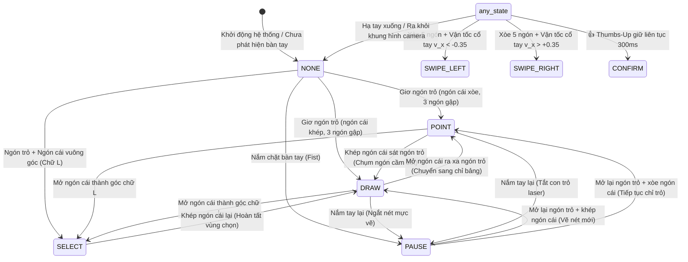

# AIRTEACH AI - GESTURE FINITE-STATE MACHINE (FSM)
## Cỗ Máy Trạng Thái Cử Chỉ Nhận Diện Bàn Tay Độc Lập Khoảng Cách

**Dự án:** AirTeach AI — Hệ thống dạy học thông minh tương tác không chạm bằng AI  
**Vị trí cài đặt:** `src/core/hand_gesture_engine.py` (Lớp `HandGestureFSM`)  
**Mục tiêu:** Cung cấp tài liệu kỹ thuật chuẩn xác về cỗ máy trạng thái hữu hạn 6 cử chỉ, các thuật toán hình học chuẩn hóa tỉ lệ bàn tay bất biến khoảng cách, cơ chế khử nhiễu (debouncing) và phòng chống vẽ nhầm.

---

### 1. DANH MỤC 6 CỬ CHỈ TƯƠNG TÁC SƯ PHẠM CHUẨN

| Cử chỉ | Trạng thái FSM | Tư thế Bàn tay Vật lý | Hành động tương ứng trên Bảng Giảng dạy | Ngưỡng Kỹ thuật |
| :--- | :--- | :--- | :--- | :--- |
| **Chỉ trỏ / Tia Laser** | `POINT` | Ngón trỏ vươn thẳng, ngón cái xòe mở rộng, 3 ngón còn lại gập sát lòng bàn tay. | Hiển thị chấm laser đỏ kèm vòng hào quang bán trong suốt di chuyển theo đầu ngón trỏ để giáo viên hướng sự chú ý của học sinh. | Ngón trỏ vươn, 3 ngón gập, $r_{\text{thumb}} > 0.38$ |
| **Vẽ nét viết bảng** | `DRAW` | Ngón trỏ vươn thẳng, ngón cái khép sát hoặc chạm nhẹ vào ngón trỏ (tư thế cầm bút tự nhiên), 3 ngón còn lại gập. | Kích hoạt bộ thu nhận nét vẽ số (Vector Smart Ink), ghi nhận tọa độ qua bộ lọc 1€ Filter và hiển thị nét mực tươi tức thì. | Ngón trỏ vươn, 3 ngón gập, $r_{\text{thumb}} \le 0.38$ |
| **Nắm tay / Nhấc bút** | `PAUSE` | Bàn tay nắm chặt lại thành hình quả đấm (Fist — toàn bộ 5 ngón đều gập vào lòng bàn tay). | Ngắt nét vẽ hiện tại, hoàn thiện nét mực (`_finalize_stroke()`), kích hoạt bộ đệm nắn hình học và ẩn tia laser con trỏ. | Cả 5 ngón tay đều ở trạng thái gập (`curled`) |
| **Chọn vùng bài giảng** | `SELECT` | Ngón trỏ và ngón cái mở vuông góc thành hình chữ L, 3 ngón còn lại gập. | Kéo khung chữ nhật nét đứt màu xanh dương để khoanh vùng bài học phục vụ OCR, nắn công thức toán hoặc gửi hỏi Gemini AI. | Ngón trỏ vươn, ngón cái mở góc $\approx 90^\circ$, 3 ngón gập |
| **Gạt trang bài giảng** | `SWIPE_LEFT` `SWIPE_RIGHT` | Bàn tay mở xòe cả 5 ngón và gạt dứt khoát sang trái hoặc sang phải trong không gian. | Lùi lại trang bài giảng trước (`SWIPE_LEFT`) hoặc tiến tới trang bài giảng tiếp theo (`SWIPE_RIGHT`). | Cả 5 ngón vươn thẳng, vận tốc cổ tay $\|v_x\| \ge 0.35$, cooldown 800ms |
| **Xác nhận / Lưu bảng** | `CONFIRM` | Bàn tay nắm lại, chỉ riêng ngón cái giơ thẳng đứng lên trên (👍 Thumbs-Up). | Giữ yên trong 300ms để xác nhận lưu trang bài giảng hiện tại hoặc chấp nhận kết quả nắn hình học tự động. | Ngón cái vươn thẳng lên trên, 4 ngón còn lại gập, giữ liên tục $\ge 300\text{ ms}$ |

---

### 2. SƠ ĐỒ CHUYỂN DỊCH TRẠNG THÁI (STATE TRANSITION DIAGRAM)

---

### 3. CƠ CHẾ TOÁN HỌC & GIẢI THUẬT ĐẢM BẢO TÍNH ỔN ĐỊNH

#### 3.1. Chuẩn hóa Tỉ lệ Bàn tay Bất biến Khoảng cách (Scale-Invariance)
Khoảng cách pixel giữa các ngón tay sẽ co lại khi giáo viên đứng xa camera và giãn rộng ra khi giáo viên đứng gần. Để ngưỡng nhận diện hoạt động ổn định ở mọi khoảng cách từ 0.5m đến 2.5m, thuật toán chuẩn hóa toàn bộ các khoảng cách theo kích thước đặc trưng của lòng bàn tay $L_{\text{hand}}$:

$$L_{\text{hand}} = \|P_0 - P_9\|_2 = \sqrt{(x_9 - x_0)^2 + (y_9 - y_0)^2 + (z_9 - z_0)^2}$$

Trong đó:
- $P_0$: Điểm mốc Cổ tay (Wrist Landmark).
- $P_9$: Điểm mốc Khớp gốc ngón giữa (Middle Finger MCP).

Tỉ lệ khoảng cách ngón cái - ngón trỏ được tính bằng:
$$r_{\text{thumb}} = \frac{\|P_4 - P_6\|_2}{L_{\text{hand}}}$$

- Nếu $r_{\text{thumb}} \le 0.38 \implies \text{DRAW}$ (Ngón cái chụm sát đốt thứ hai ngón trỏ).
- Nếu $r_{\text{thumb}} > 0.38 \implies \text{POINT}$ (Ngón cái mở rộng tự nhiên).

#### 3.2. Thuật toán Kiểm tra Ngón tay Gập (Finger Curl Algorithm)
Để phát hiện ngón tay có đang gập vào lòng bàn tay hay không mà không bị ảnh hưởng bởi góc xoay của bàn tay:
- Với mỗi ngón $f \in \{\text{Middle}, \text{Ring}, \text{Pinky}\}$:
  $$d_{\text{tip}} = \|P_{\text{tip}} - P_0\|_2 \quad (\text{Khoảng cách từ Cổ tay tới Đầu ngón})$$
  $$d_{\text{mcp}} = \|P_{\text{mcp}} - P_0\|_2 \quad (\text{Khoảng cách từ Cổ tay tới Khớp gốc})$$
- Ngón tay được xác định là gập (`curled`) khi:
  $$d_{\text{tip}} \le d_{\text{mcp}} \cdot 1.15$$
- Điều này loại bỏ hoàn toàn hiện tượng nhận diện nhầm bàn tay xòe mở thành cử chỉ vẽ hoặc con trỏ laser.

#### 3.3. Bộ đệm Khử rung Nhấp nháy (Debounce Counter)
- Khi cử chỉ mới được phân loại, hệ thống không chuyển trạng thái ngay lập tức mà yêu cầu cử chỉ đó phải xuất hiện liên tục trong tối thiểu **3 khung hình kế tiếp** (`debounce_frames = 3`):
  $$\text{count}_{\text{candidate}} \ge 3 \implies \text{State}_{\text{active}} \leftarrow \text{State}_{\text{candidate}}$$
- Cơ chế này loại bỏ hoàn toàn các khung hình nhiễu cảm biến hoặc dao động ngón tay ngẫu nhiên trong chớp mắt.

#### 3.4. Cử chỉ Gạt trang Trượt (Horizontal Swipe Detection)
- Điều kiện cần: Cả 5 ngón tay đều vươn thẳng (`_all_fingers_open`).
- Điều kiện đủ: Vận tốc cổ tay theo phương ngang trong cửa sổ trượt thời gian 250ms vượt quá ngưỡng:
  $$v_x = \frac{x_{\text{wrist}}(t) - x_{\text{wrist}}(t - \Delta t)}{\Delta t}$$
  - $v_x \le -0.35\text{ units/s} \implies \text{SWIPE\_LEFT}$ (Chuyển về trang trước).
  - $v_x \ge +0.35\text{ units/s} \implies \text{SWIPE\_RIGHT}$ (Chuyển sang trang sau).
- Thời gian hồi chiêu (Cooldown): $800\text{ ms}$ khóa gạt trang liên tiếp nhằm tránh hiện tượng nhảy nhiều trang ngoài ý muốn.
