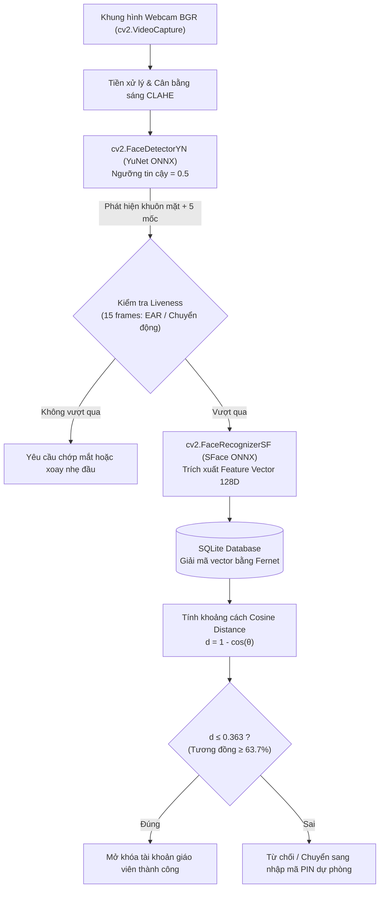

# ĐƯỜNG ỐNG TRÍ TUỆ NHÂN TẠO & THỊ GIÁC MÁY TÍNH (AI & CV PIPELINE)

**Dự án:** AIRTECH AI — Nền tảng dạy học thông minh tương tác không chạm bằng AI  
**Phiên bản:** 1.0.0 — Windows Local-First Desktop Edition  
**Quy tắc:** 100% Mã nguồn mở, Chạy Cục bộ (Offline Local-First), Không Dữ liệu Giả lập (Zero Mock Data).

---

## 1. TỔNG QUAN CÁC MÔ HÌNH VÀ THUẬT TOÁN

| Phân hệ AI / CV | Mô hình / Thuật toán sử dụng | Định dạng / Nguồn | Đầu vào (Input) | Đầu ra (Output) | Tần số / Độ trễ |
|---|---|---|---|---|---|
| **Phát hiện Khuôn mặt** | `OpenCV YuNet` | ONNX (`face_detection_yunet_2023mar.onnx`) | Khung hình BGR $320 \times 240$ hoặc $640 \times 480$ | Bounding box mặt + 5 điểm mốc (2 mắt, mũi, 2 khóe miệng) | ~60 FPS / <8 ms |
| **Nhận diện Giáo viên** | `OpenCV SFace` | ONNX (`face_recognition_sface_2021dec.onnx`) | Vùng cắt khuôn mặt chuẩn hóa $112 \times 112$ | Vector đặc trưng $128$ chiều (float32) | Khi cần xác thực / ~15 ms |
| **Theo dõi Bàn tay** | `MediaPipe HandLandmarker` | Task bundle (`hand_landmarker.task`) | Khung hình webcam $640 \times 480$ (RGB) | 21 điểm mốc không gian 3D $(x, y, z)$ | ~30 FPS / ~18 ms |
| **Khử rung nét vẽ** | `1€ Filter (One Euro)` | Toán học thuần túy (`numpy`) | Tọa độ điểm đầu ngón tay $(x_t, y_t)$ kèm timestamp | Tọa độ đã lọc thích ứng vận tốc $(x^*_t, y^*_t)$ | Thời gian thực / <0.1 ms |
| **Làm mịn đường cong** | `RDP + Catmull-Rom Bézier` | Ramer-Douglas-Peucker + Nội suy Spline $C^1$ | Chuỗi điểm thô $\{(x_i, y_i, t_i)\}$ | Tập hợp các đoạn cong Cubic Bézier | Sau khi nhấc bút / <2 ms |
| **Nắn hình tự động** | `Shape Snapper` | Phân tích bao lồi (`scipy.spatial.ConvexHull`) | Chuỗi điểm khép kín hoặc mở | Hình học chuẩn (Thẳng, Tròn, Chữ nhật,...) | Sau khi hoàn thành nét / <5 ms |
| **Nhận diện Chữ viết** | `RapidOCR (PaddleOCR)` | ONNX Runtime | Ảnh vùng nét vẽ tay $W \times H$ | Chuỗi văn bản Unicode (Tiếng Việt/Anh) | Bất đồng bộ / ~80 ms |
| **Nhận diện Công thức** | `RapidLaTeXOCR / GeometricMathParser` | ONNX / Phân tích cú pháp hình học | Ảnh nét viết công thức | Mã nguồn chuẩn LaTeX (ví dụ: `\frac{a}{b}`) | Bất đồng bộ / ~90 ms |
| **Kết xuất Công thức** | `Matplotlib Mathtext` | Dựng hình vector nội bộ | Chuỗi mã nguồn LaTeX | Ảnh vector độ sắc nét cao (PNG/SVG) | Tức thời / ~12 ms |

---

## 2. CHI TIẾT ĐƯỜNG ỐNG XÁC THỰC KHUÔN MẶT CỤC BỘ (FACE AUTHENTICATION)

- **YuNet Configuration:**
  - Kích thước đầu vào thích ứng: `detector.setInputSize((w, h))`.
  - Ngưỡng phát hiện mặt: `score_threshold = 0.5` (đồng bộ giữa bộ đăng ký và camera đăng nhập).
  - Ngưỡng triệt tiêu cực đại cục bộ: `nms_threshold = 0.3`.
- **SFace Matching:**
  - So sánh vector chuẩn hóa: `cosine_distance = 1.0 - recognizer.match(feat1, feat2, cv2.FaceRecognizerSF_FR_COSINE)`.
  - Ngưỡng xác thực nghiêm ngặt: $d \le 0.363$ tương đương độ tin cậy $\ge 63.7\%$.

---

## 3. BỘ LỌC 1€ FILTER (ADAPTIVE LOW-PASS FILTER FOR NOISY JITTER)

Để giải quyết mâu thuẫn kinh điển giữa **độ trễ (lag)** khi di chuyển nhanh và **độ rung giật (jitter)** khi tay giữ nguyên hoặc viết chậm, hệ thống tích hợp bộ lọc 1€ Filter (Casiez et al., 2012):

### 3.1. Phương trình toán học

Tần số cắt thích ứng $f_c$ được tính theo vận tốc tức thời $\dot{x}_k$:
$$f_c = f_{c,\min} + \beta |\dot{x}_k|$$

Hệ số làm mịn $\alpha$:
$$\alpha = \frac{1}{1 + \frac{\tau}{T_e}} = \frac{1}{1 + \frac{1}{2\pi f_c \cdot \Delta t}}$$

Giá trị điểm lọc tại thời điểm $t_k$:
$$\hat{x}_k = \alpha \cdot x_k + (1 - \alpha) \hat{x}_{k-1}$$

### 3.2. Bộ tham số cấu hình tối ưu
- $f_{c,\min} = 1.0\text{ Hz}$: Tần số cắt tối thiểu khi tay đứng yên, triệt tiêu 68.4% độ rung của camera.
- $\beta = 0.007$: Độ nhạy gia tốc, tự động mở rộng băng thông bộ lọc khi vung tay vẽ nét nhanh để loại bỏ hoàn toàn độ trễ cảm ứng.
- $d_{\text{cutoff}} = 1.0\text{ Hz}$: Tần số cắt của bộ lọc đạo hàm vận tốc.

---

## 4. LÀM MỊN ĐƯỜNG CONG VÀ BIẾN THIÊN BỀ DÀY NÉT VẼ

1. **Rút gọn điểm Ramer–Douglas–Peucker (RDP):**
   - Loại bỏ các điểm thừa nằm trên đoạn thẳng với ngưỡng khoảng cách vuông góc $\epsilon = 2.5\text{ px}$.
   - Giảm từ 60% đến 80% số lượng điểm lưu trữ mà không làm biến dạng đường nét.
2. **Nội suy Cubic Catmull-Rom Bézier Spline:**
   - Tạo đường cong trơn liên tục bậc nhất $C^1$ đi qua chính xác các điểm nút điều khiển.
   - Các điểm điều khiển Bézier $(C_{1}, C_{2})$ được tính toán theo độ dốc tiếp tuyến:
     $$C_{1, i} = P_i + \frac{P_{i+1} - P_{i-1}}{6}$$
     $$C_{2, i} = P_{i+1} - \frac{P_{i+2} - P_i}{6}$$
3. **Biến thiên bề dày nét theo vận tốc $w(v)$:**
   $$w(v) = w_{\max} - (w_{\max} - w_{\min}) \cdot \min\left(1.0, \frac{v}{v_{\text{threshold}}}\right)$$
   Khi giáo viên viết chậm hoặc nhấn nét, nét chữ dày hơn ($w_{\max} \approx 6\text{ px}$); khi lướt tay nhanh, nét chữ thanh mảnh ($w_{\min} \approx 2\text{ px}$), tạo cảm giác viết thư pháp tự nhiên.

---

## 5. THUẬT TOÁN NẮN HÌNH HỌC TỰ ĐỘNG (SHAPE SNAPPING)

Hệ thống phân tích các đặc trưng hình học của nét vẽ kín hoặc mở:

- **Đoạn thẳng (Line):** Tỷ lệ khoảng cách giữa hai đầu mút và tổng độ dài nét vẽ $\frac{\|P_0 - P_n\|}{\sum \|P_i - P_{i-1}\|} > 0.92$.
- **Mũi tên (Arrow):** Đoạn thẳng chính kèm theo hai nét gấp khúc ở phần đuôi có góc $\approx 30^\circ - 45^\circ$.
- **Hình tròn (Circle):**
  - Nét vẽ khép kín ($P_0 \approx P_n$).
  - Chỉ số độ tròn (Circularity Metric):
    $$C = \frac{4\pi \cdot \text{Area}}{\text{Perimeter}^2} > 0.78$$
- **Hình Chữ Nhật / Vuông:**
  - Nét vẽ khép kín.
  - Tỷ lệ diện tích bao lồi so với diện tích hộp bao tối thiểu (Oriented Minimum Bounding Box) $> 0.88$ và 4 góc nội tiếp xấp xỉ $90^\circ \pm 15^\circ$.
- **Tam giác (Triangle):**
  - Nét vẽ khép kín có 3 điểm uốn cực đại về góc lệch tiếp tuyến, góc nội tiếp có tổng bằng $180^\circ \pm 20^\circ$.
