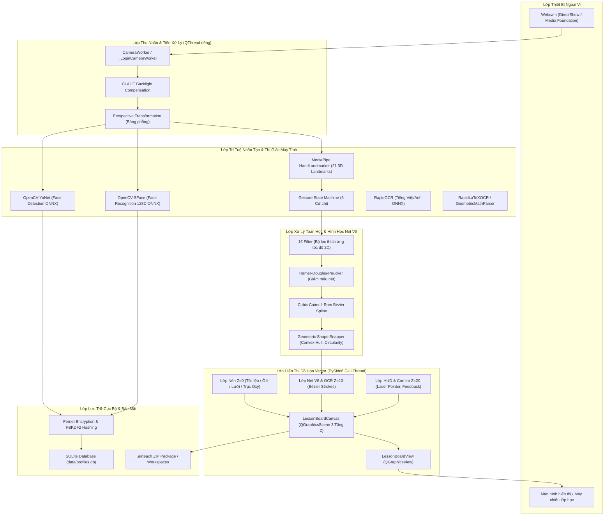
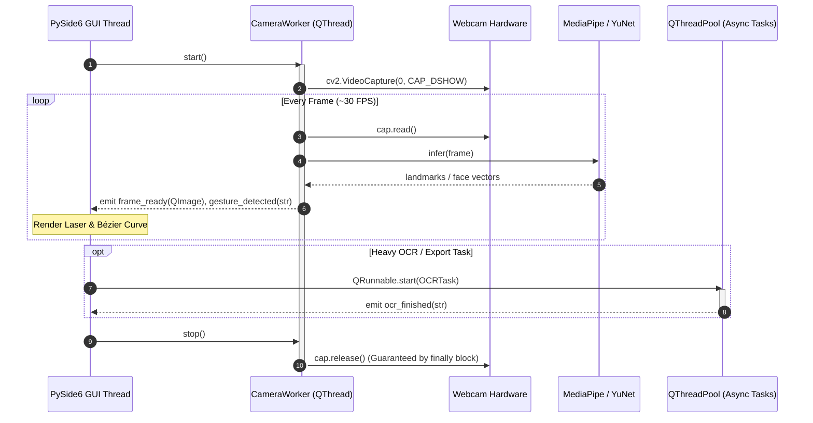

# KIẾN TRÚC HỆ THỐNG AIRTEACH AI (SYSTEM ARCHITECTURE)

**Dự án:** AIRTECH AI — Nền tảng dạy học thông minh tương tác không chạm bằng AI  
**Phiên bản:** 1.0.0 — Windows Local-First Desktop Edition  
**Tác giả:** Principal Computer Vision & Desktop Software Architect  
**Mục tiêu thiết kế:** Local-First, Zero UI Blocking, Zero Mock Data, Bảo mật thông tin sư phạm.

---

## 1. TỔNG QUAN KIẾN TRÚC VÀ NGUYÊN TẮC THIẾT KẾ (ARCHITECTURAL OVERVIEW)

AIRTECH AI được thiết kế theo mô hình **Local-First Component-Based Architecture** trên nền tảng desktop Windows. Mọi thao tác cốt lõi bao gồm thu nhận hình ảnh, nhận diện cử chỉ bàn tay, làm mịn và nắn hình học nét vẽ vector, nhận diện khuôn mặt giáo viên, lưu trữ bài giảng và trích xuất chữ viết/toán học đều được thực thi 100% cục bộ trên thiết bị của giáo viên mà không phụ thuộc vào kết nối mạng Internet.



---

## 2. NGUYÊN TẮC BẤT BIẾN: ZERO UI BLOCKING (CƠ CHẾ ĐA LUỒNG)

Giao diện người dùng PySide6 (`QApplication` GUI Thread) đảm bảo tốc độ phản hồi 60 FPS, tuyệt đối không bị nghẽn (freeze/lag) bởi các tác vụ nặng.

### Phân bổ luồng xử lý (Thread Segregation)

1. **Luồng Giao diện Chính (Main GUI Thread):**
   - Quản lý vòng lặp sự kiện `QEventLoop`.
   - Dựng hình vector trên `QGraphicsView` và `QGraphicsScene`.
   - Tiếp nhận tín hiệu `Signal` từ các worker thread và cập nhật giao diện đồ họa.
2. **Luồng Thu hình & Cử chỉ Camera (`CameraWorker` - QThread):**
   - Chạy vòng lặp chụp ảnh `cv2.VideoCapture` với backend DirectShow (`cv2.CAP_DSHOW`).
   - Cân bằng độ sáng cục bộ CLAHE và chuyển đổi không gian màu.
   - Gọi suy luận MediaPipe HandLandmarker trích xuất 21 điểm mốc 3D.
   - Đưa dữ liệu qua máy trạng thái cử chỉ (FSM) và bộ lọc 1€ Filter.
   - Phát tín hiệu `frame_ready(QImage)` và `landmarks_ready(dict)` sang GUI thread theo cơ chế `Qt.QueuedConnection`.
3. **Luồng Xác thực Khuôn mặt (`_LoginCameraWorker` - QThread):**
   - Chạy vòng lặp độc lập tại màn hình đăng nhập.
   - Thực hiện kiểm tra liveness (15 khung hình) và suy luận YuNet + SFace.
   - Đảm bảo giải phóng DirectShow device an toàn trong khối `finally: cap.release()`.
4. **Hồ bơi luồng bất đồng bộ (`QThreadPool` / `QRunnable`):**
   - Dành cho các tác vụ: Nhận diện chữ viết RapidOCR, nhận diện công thức LaTeX-OCR, nhập tài liệu PPTX/DOCX qua LibreOffice/COM, xuất file PDF in ấn, và gọi Gemini API qua mạng.



---

## 3. LỚP DỰNG HÌNH VECTOR VÀ PHÂN TẦNG ĐỒ HỌA (3-LAYER Z-ORDER)

Không gian vẽ của bảng giảng dạy tương tác (`LessonBoardCanvas`) được tổ chức theo cấu trúc đồ thị phân lớp Z-Order nghiêm ngặt, kế thừa từ `QGraphicsScene`:

| Lớp (Layer) | Giá trị Z | Thành phần chứa | Hành vi & Tương tác |
|---|---|---|---|
| **Lớp Nền (Background Layer)** | $Z = 0$ | Ảnh nền tài liệu PDF/PPTX dựng ở 144 DPI, hoặc mẫu lưới học sinh (`BackgroundTemplateGenerator`: Ô li, Dòng kẻ, Trục Oxy, Trắng). | Cố định, không nhận sự kiện chọn/xóa, tự động co giãn theo tỷ lệ khung nhìn. |
| **Lớp Nét Viết (Ink & Content Layer)** | $Z = 10$ | Các nét vẽ tay vector (`SmoothPathItem`), hình học nắn chuẩn (`QGraphicsPathItem`), văn bản OCR, công thức LaTeX vector. | Nhận sự kiện chọn nét, xóa nét, phân tách độc lập theo từng trang tài liệu (Multi-page Stroke Segregation). |
| **Lớp Chỉ thị & Con trỏ (HUD & Feedback Layer)** | $Z = 20$ | Chấm con trỏ laser ngón tay (`LaserPointerItem`), vòng tròn phản hồi cử chỉ (Gesture Feedback Ring), bounding box nhận diện tạm thời. | Luôn hiển thị trên cùng, cập nhật ở tần số 60 FPS theo tọa độ ngón trỏ. |

---

## 4. BẢO MẬT HỒ SƠ GIÁO VIÊN & PHÂN TÁCH WORKSPACE

Hệ thống bảo vệ quyền riêng tư và tài liệu của giáo viên theo các tiêu chuẩn mật mã học hiện đại:

1. **Lưu trữ vector sinh trắc học:**
   - Vector đặc trưng khuôn mặt 128 chiều từ SFace được tuần tự hóa dạng mảng byte nhị phân IEEE 754 float32.
   - Mã hóa đối xứng bằng thuật toán `Fernet` (kết hợp AES-128-CBC và HMAC-SHA256). Khóa mã hóa được sinh ngẫu nhiên và lưu tại vị trí bảo mật của hệ thống.
2. **Mã PIN dự phòng:**
   - Băm mật khẩu bằng thuật toán chuẩn hóa `hashlib.pbkdf2_hmac('sha256', pin, salt, 100000)`.
   - Mỗi giáo viên sở hữu một chuỗi muối (`salt`) ngẫu nhiên 16 bytes chống tấn công bảng băm (rainbow table).
3. **Phân vùng dữ liệu độc lập (Workspace Isolation):**
   - Mỗi giáo viên được cấp một định danh duy nhất UUIDv4 (`teacher_uuid`).
   - Thư mục dữ liệu và bài giảng được lưu riêng biệt tại `data/workspaces/<teacher_uuid>/`. Khi giáo viên đăng xuất hoặc chuyển tài khoản, ứng dụng tự động dọn dẹp bộ nhớ đệm và trỏ không gian làm việc sang thư mục của giáo viên mới.

---

## 5. ĐỊNH DẠNG TỆP GÓI BÀI GIẢNG `.airteach`

Tệp bài giảng `.airteach` là tệp nén chuẩn định dạng ZIP, cho phép lưu trữ trọn vẹn tiến trình giảng dạy để tái hiện hoặc chia sẻ:

```
lecture_session.airteach (ZIP Archive)
├── manifest.json              # Thông tin bài giảng: Tiêu đề, môn học, UUID giáo viên, số trang, ngày tạo
├── pages/                     # Ảnh kết xuất từng trang tài liệu nền (PNG độ phân giải cao 144 DPI)
│   ├── page_1.png
│   └── page_2.png
├── ink/                       # Dữ liệu vector nét vẽ của từng trang
│   └── strokes.json           # Tọa độ điểm Bézier, độ dày, màu sắc và mảng timestamp_ms
├── recognized/                # Kết quả nhận diện chữ viết và công thức
│   └── items.json             # Danh sách hộp thoại text OCR, mã LaTeX và tọa độ bounding box
└── links.json                 # Mã băm SHA-256 xác thực tệp tài liệu nguồn gốc
```
