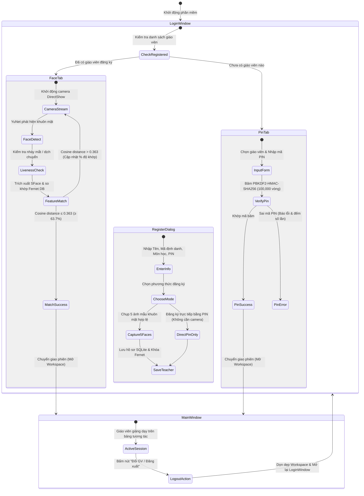
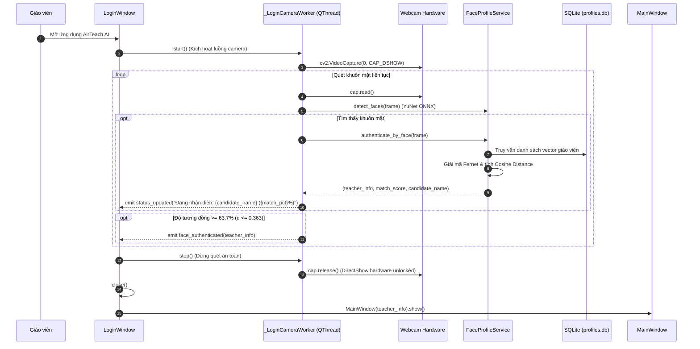

# QUY TRÌNH XÁC THỰC VÀ QUẢN LÝ PHIÊN GIÁO VIÊN (TEACHER AUTHENTICATION FLOW)

**Dự án:** AIRTECH AI — Nền tảng dạy học thông minh tương tác không chạm bằng AI  
**Phiên bản:** 1.0.0 — Windows Local-First Desktop Edition  
**Mục tiêu bảo mật:** 100% Cục bộ (Local-First), Không lưu trữ đám mây, Mã hóa Fernet & PBKDF2 SHA-256.

---

## 1. TỔNG QUAN QUY TRÌNH XÁC THỰC

Hệ thống xác thực giáo viên của AIRTECH AI được thiết kế đa phương thức (Multi-modal Authentication) kết hợp giữa **Nhận diện Sinh trắc học Khuôn mặt Offline** và **Mã PIN Bảo mật Dự phòng**. Quy trình đảm bảo tính sẵn sàng cao ngay cả khi giáo viên giảng dạy trong phòng tối, camera bị hỏng, hoặc môi trường có ánh sáng ngược mạnh.

---

## 2. QUY TRÌNH ĐĂNG KÝ HỒ SƠ GIÁO VIÊN MỚI (TEACHER ENROLLMENT)

Nhằm giải quyết triệt để lỗi người dùng bị kẹt lại form đăng ký khi nhận diện camera không đủ điều kiện ánh sáng, hệ thống cung cấp 2 phương thức linh hoạt:

1. **Phương thức 1: Đăng ký đầy đủ bằng Khuôn mặt + Mã PIN (Khuyến nghị):**
   - Giáo viên nhập thông tin cơ bản: Họ tên, Mã giáo viên (duy nhất), Môn học phụ trách và Mã PIN gồm 4-6 chữ số.
   - Hệ thống kích hoạt camera và tự động chụp **5 khung hình khuôn mặt chất lượng cao** (độ tin cậy của YuNet $\ge 0.50$, khuôn mặt rõ nét, không bị khuất bóng).
   - Mỗi khung hình được trích xuất vector đặc trưng 128 chiều bằng mô hình SFace, sau đó tính vector trung bình để tối ưu hóa độ nhận diện.
   - Vector trung bình được mã hóa đối xứng bằng `Fernet` và lưu vào cơ sở dữ liệu `data/profiles.db`.
2. **Phương thức 2: Đăng ký nhanh bằng Mã PIN (PIN-Only Mode):**
   - Áp dụng khi phòng học thiếu webcam, máy tính chưa cấu hình driver hoặc ánh sáng quá tối.
   - Giáo viên tích chọn *"Chỉ tạo bằng mã PIN (không cần camera)"*.
   - Hồ sơ được khởi tạo tức thời với vector khuôn mặt rỗng (`b""`). Giáo viên có thể cập nhật mẫu khuôn mặt bổ sung bất kỳ lúc nào trong phần Cài đặt.
3. **Cơ chế Fallback thông minh khi đăng ký:**
   - Nếu trong quá trình chụp 5 ảnh mẫu mà camera bị ngắt hoặc giáo viên di chuyển ra ngoài khung hình quá 15 giây, hệ thống hiển thị thông báo: *"Chưa thu đủ 5 khung hình khuôn mặt rõ nét. Bạn có muốn hoàn tất đăng ký ngay bằng mã PIN dự phòng không?"*.
   - Cho phép giáo viên tiếp tục ngay lập tức mà không phải nhập lại biểu mẫu từ đầu.

---

## 3. QUY TRÌNH ĐĂNG NHẬP BẰNG KHUÔN MẶT THỜI GIAN THỰC (REAL-TIME FACE LOGIN)

- **Phản hồi thời gian thực trên giao diện:**
  Giao diện hiển thị trực tiếp thanh tiến trình màu sắc và nhãn văn bản:
  - Màu xám: *"Chưa phát hiện khuôn mặt"*
  - Màu vàng cam: *"Đang nhận diện: Thầy Nguyễn Văn A (Độ khớp: 45.2% - Yêu cầu >= 63.7%)"*
  - Màu xanh lá: *"Xác thực thành công! Đang chuyển vào không gian làm việc..."*

---

## 4. CHUYỂN GIAO PHIÊN VÀ ĐĂNG XUẤT AN TOÀN (SESSION HANDOVER & LOGOUT)

Nhằm đảm bảo tính liên tục trong các phòng học có nhiều giáo viên luân phiên giảng dạy:

1. **Hiển thị thông tin phiên (Teacher Profile Badge):**
   - Trên thanh công cụ đỉnh của `MainWindow`, hệ thống hiển thị huy hiệu: `👤 {teacher_name} ({subject})` cùng thời gian bắt đầu phiên.
2. **Nút "Đổi GV / Đăng xuất":**
   - Cho phép giáo viên kết thúc tiết giảng với một thao tác duy nhất.
   - Phần mềm kiểm tra và lưu tự động các nét vẽ chưa lưu vào file nháp phiên.
   - Phát tín hiệu `logout_requested(teacher_info)` và kích hoạt `_open_login_window()`.
   - Cửa sổ chính đóng an toàn, giải phóng camera bảng giảng dạy, sau đó khởi động lại `LoginWindow` để giáo viên tiếp theo đăng nhập.
