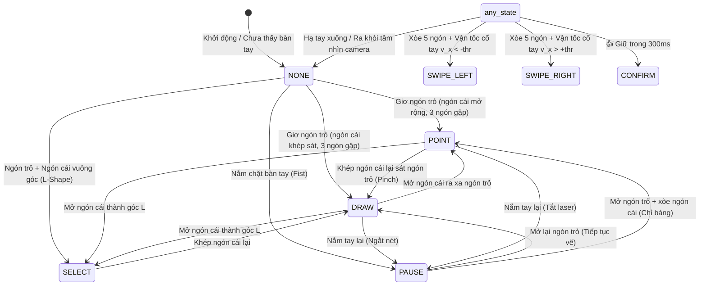

# AIRTEACH AI - GESTURE FINITE-STATE MACHINE (FSM)
## Cỗ Máy Trạng Thái Cử Chỉ Nhận Diện Bàn Tay Độc Lập Khoảng Cách

Tài liệu kỹ thuật giải thích chi tiết hoạt động của `HandGestureFSM` trong `src/core/hand_gesture_engine.py`.

---

### 1. DANH MỤC 6 CỬ CHỈ TƯƠNG TÁC SƯ PHẠM

| Trạng thái | Cử chỉ Vật lý | Hành động tương ứng trên Bảng giảng dạy |
| :--- | :--- | :--- |
| **POINT** | Ngón trỏ vươn thẳng, ngón cái xòe rộng, 3 ngón còn lại gập lại. | Hiển thị chấm laser đỏ kèm vòng phát quang để giáo viên chỉ bảng. |
| **DRAW** | Ngón trỏ vươn thẳng, ngón cái khép sát hoặc chạm ngón trỏ (như cầm bút), 3 ngón còn lại gập lại. | Bắt đầu ghi nhận nét vẽ số (Vector Smart Ink) với bộ lọc 1€ Filter. |
| **PAUSE** | Bàn tay nắm lại thành nắm đấm (Fist - tất cả 5 ngón đều gập). | Tạm dừng nét vẽ hiện tại, ngắt nét và đẩy vào bộ đệm nắn hình học. |
| **SELECT** | Ngón trỏ và ngón cái tạo thành chữ L (hoặc mở góc vuông), 3 ngón còn lại gập. | Kéo khung chữ nhật chọn vùng bài học để OCR hoặc gửi Gemini AI. |
| **SWIPE_LEFT** | Xòe cả 5 ngón tay (bàn tay mở) và gạt nhanh sang bên trái. | Lùi lại trang bài giảng trước (Previous Page). |
| **SWIPE_RIGHT**| Xòe cả 5 ngón tay (bàn tay mở) và gạt nhanh sang bên phải. | Tiến tới trang bài giảng kế tiếp (Next Page). |
| **CONFIRM** | Bàn tay nắm lại, chỉ ngón cái giơ thẳng đứng lên trên (👍 Thumbs-Up). | Giữ trong 300ms để xác nhận thao tác hoặc đồng ý lưu bảng. |

---

### 2. SƠ ĐỒ CHUYỂN TRẠNG THÁI (STATE TRANSITION DIAGRAM)

---

### 3. CƠ CHẾ TOÁN HỌC ĐẢM BẢO ĐỘ ỔN ĐỊNH

#### A. Chuẩn hóa Tỉ lệ Bàn tay (Scale-Invariance)
Tất cả các khoảng cách hình học giữa các khớp ngón tay đều được chia cho độ dài đặc trưng $L_{\text{hand}}$:
$$L_{\text{hand}} = \|P_0 - P_9\|_2 \quad (\text{Khoảng cách từ Cổ tay P0 đến Khớp gốc ngón giữa P9})$$
- Tỉ lệ khoảng cách ngón cái - ngón trỏ:
  $$r_{\text{thumb}} = \frac{\|P_4 - P_6\|_2}{L_{\text{hand}}}$$
- Ngưỡng phân loại:
  - Nếu $r_{\text{thumb}} \le 0.38 \implies \text{DRAW}$
  - Nếu $r_{\text{thumb}} > 0.38 \implies \text{POINT}$

#### B. Bộ đệm chống rung nhấp nháy (Debounce Counter)
Để ngăn ngừa tình trạng trạng thái cử chỉ bị nhấp nháy liên tục do dao động khung hình:
- Trạng thái mới chỉ được kích hoạt khi cử chỉ đó duy trì ổn định qua tối thiểu **3 khung hình liên tiếp** (`debounce_frames = 3`).
- Riêng cử chỉ `CONFIRM` (👍 Thumbs-Up) yêu cầu bộ đếm thời gian thực giữ liên tục tối thiểu **300ms** (`confirm_hold_ms = 300`).

#### C. Phát hiện Gạt trang (Swipe Detection)
- Điều kiện cần: Toàn bộ 5 ngón tay đều vươn thẳng (`_all_fingers_open`).
- Điều kiện đủ: Vận tốc cổ tay theo trục ngang trong cửa sổ trượt 250ms vượt quá ngưỡng:
  $$|v_x| = \frac{|\Delta x_{\text{wrist}}|}{\Delta t} \ge 0.35\text{ normalized units/sec}$$
- Thời gian hồi chiêu (Cooldown): 800ms giữa 2 lần gạt liên tiếp để tránh nhảy nhiều trang một lúc.
