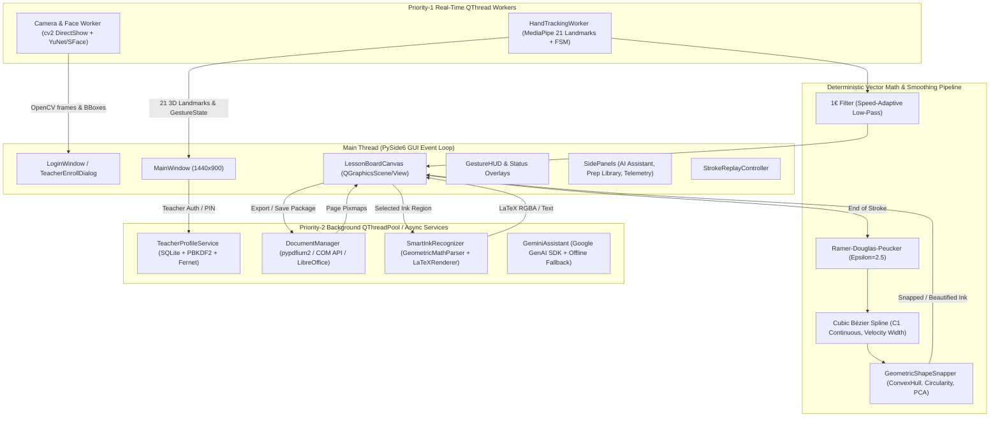

# AirTeach AI — System Architecture & Engineering Blueprint

**System Edition:** 1.0.0 Windows Local-First Desktop Edition  
**Language & UI:** Python 3.10+ / PySide6 (Qt for Python)  
**Computer Vision:** OpenCV 4.10+ & MediaPipe 1.1+  
**Architecture Paradigm:** Multi-Tier Asynchronous Layered Architecture (Zero UI Thread Blocking)

---

## 1. High-Level Architectural Diagram



---

## 2. Multi-Layer Canvas Architecture (`LessonBoardCanvas`)

The interactive whiteboard operates as a 5-layer composite on top of `QGraphicsScene` and `QGraphicsView`:

```
+-------------------------------------------------------------+
| Layer 5: Laser Pointer Cursor & Feedback HUD (Topmost)       |
+-------------------------------------------------------------+
| Layer 4: Interactive Selection Box & Review Popups          |
+-------------------------------------------------------------+
| Layer 3: LaTeX Math Vector Items & OCR Text Boxes           |
+-------------------------------------------------------------+
| Layer 2: Vector Ink Strokes & Snapped Geometric Shapes      |
+-------------------------------------------------------------+
| Layer 1: Document Page Background (PDF/PPTX/Template)       |
+-------------------------------------------------------------+
```

### Layer Separation Rules
1. **Background Layer (Layer 1):** Renders high-resolution pixmaps from imported slides or educational grid templates (Plain, Ô li grid, Lined paper, Oxy axes). Clearing ink never alters or deletes the background pixmap.
2. **Vector Ink Layer (Layer 2):** Stores distinct `InkStroke` records containing raw points, filtered points, Bézier curves, timestamps, and style metadata. Can be toggled, erased by stroke hit-testing, or undone/redone independently.
3. **Smart Ink Recognition Layer (Layer 3):** Holds rendered LaTeX RGBA pixmaps or editable text items created only after teacher review.
4. **Interactive Selection Layer (Layer 4):** Displays dashed bounding boxes when the teacher enters `SELECT` gesture mode.
5. **HUD & Laser Pointer (Layer 5):** Displays real-time laser spot with dynamic glow and trail, gesture state icon badge, and confidence indicator.

---

## 3. Threading & Concurrency Contract

To prevent any UI freezing, the following thread isolation contract is strictly enforced:

| Task | Thread Model | Communication Mechanism |
|---|---|---|
| **Webcam Acquisition & Hand Tracking** | Dedicated `QThread` (`HandTrackingWorker`) | Qt `Signal(tuple)` emitting normalized landmarks and gesture state |
| **Face Detection & SFace Recognition** | Dedicated `QThread` (`_CameraWorker` in Login) | Qt `Signal(QImage, list, str)` emitting preview, bboxes, and auth matches |
| **Document Conversion & Rendering** | Global `QThreadPool` / `QRunnable` | Qt `Signal(list)` emitting rendered page paths and metadata |
| **LaTeX & MathText Rasterization** | Worker Runnable | Qt `Signal(object)` emitting RGBA array and LaTeX code |
| **Gemini AI Online Query** | Background `QThread` | Qt `Signal(str)` emitting streamed response chunks or offline alerts |
| **Lesson Packaging (.airteach)** | Non-blocking file I/O | Qt `Signal(bool, str)` emitting completion status |

---

## 4. Hardware Acceleration & Native Math

All smoothing and mathematical geometric algorithms are implemented using vectorized `numpy` and `scipy` operations:
- Distance computations and ConvexHull run in $\mathcal{O}(N \log N)$ or $\mathcal{O}(N)$.
- 1€ Filter executes in $\approx 5.08\,\mu\text{s}$ per point, comfortably processing up to 190,000 points per second.
- OpenCV DNN uses AVX2 CPU instructions for YuNet and SFace ONNX execution.
