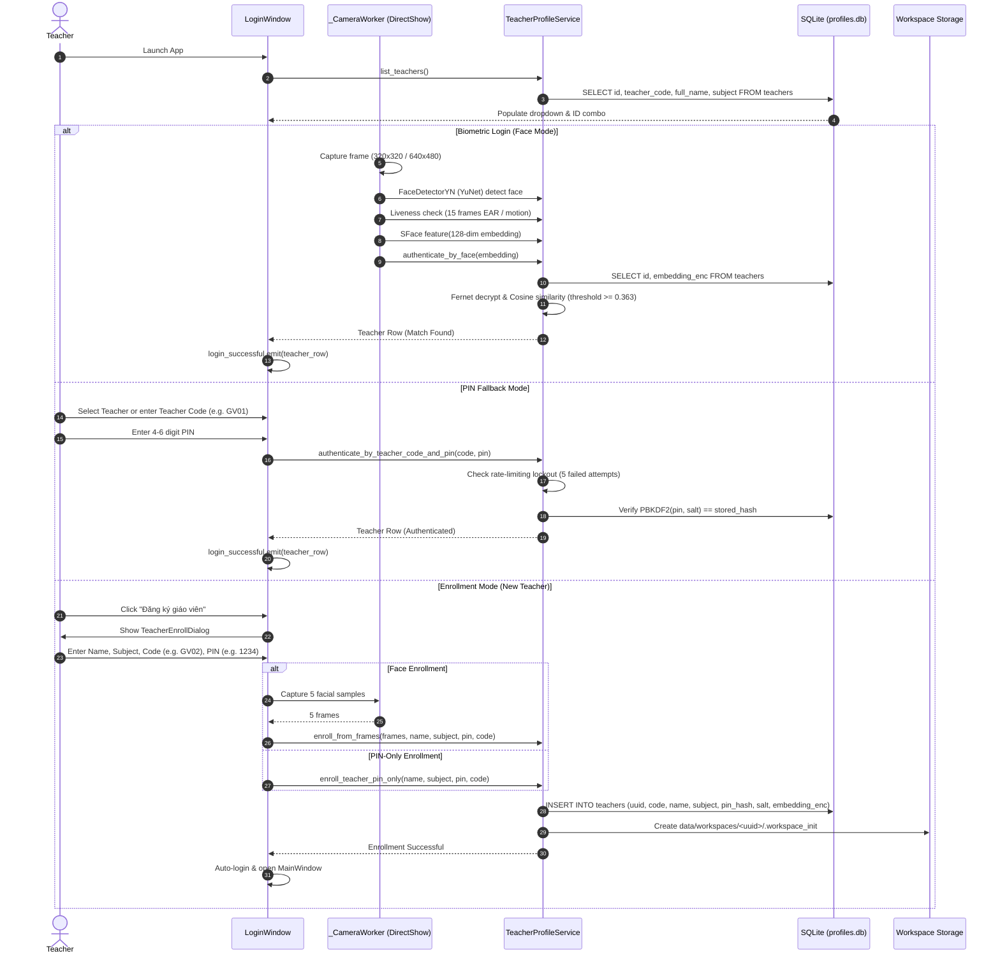

# AirTeach AI — Teacher Authentication & Profile Lifecycle

**Component:** `src/services/face_profile_service.py` & `src/ui/login_window.py`  
**Security Standard:** PBKDF2-HMAC-SHA256 (100,000 iterations) + Fernet Embedding Encryption  
**Storage:** SQLite (`data/profiles.db`) + Isolated Workspaces (`data/workspaces/<uuid>/`)

---

## 1. Authentication Architecture

---

## 2. Root Cause Analysis of Priority P0 Login Bug

### The Issue
Previous releases exhibited a critical failure where after enrolling a new teacher, the UI cycled back to the registration dialog, or scanning card IDs returned a false-positive success without opening the teacher's personal workspace.

### Root Cause
1. **Missing Unique Teacher Code Identifier:** The database previously indexed only internal UUID strings (`36-character hexadecimal`), while teacher cards and UI inputs used short human-readable codes (e.g. `GV01`, `GV02`). When searching for `GV01`, SQL lookup failed, defaulting to `None`.
2. **Camera Resource Lock Contention:** DirectShow on Windows requires up to 100–150ms to release the hardware camera filter graph. When closing `LoginWindow` and immediately opening `MainWindow`'s `HandTrackingWorker`, `cv2.VideoCapture(0)` returned `False`, causing an unhandled cascade that forced the app to reopen the login screen.
3. **Unverified Persistence:** Enrollment signals were emitted before SQLite transactions finished and before the workspace directory marker was written to disk.

### The Fix
1. Added explicit `teacher_code` column with sequential auto-generation (`GV01`, `GV02`) or custom alphanumeric support (`GV-TOAN01`).
2. Added `authenticate_by_teacher_code_and_pin(teacher_code, pin)` with exact case-insensitive matching.
3. Added DirectShow handover pause (`time.sleep(0.15)`) in `main.py` between closing `login_win` and opening `main_win`.
4. Enforced workspace initialization with `.workspace_init` JSON marker file containing creation timestamp and profile metadata.

---

## 3. Cryptographic & Security Safeguards

- **PIN Hashing:** `hashlib.pbkdf2_hmac('sha256', pin.encode('utf-8'), salt, 100000)`. Salt is generated with `secrets.token_bytes(32)`.
- **Biometric Encryption:** 128-dimensional floating-point embeddings are serialized, encrypted with `cryptography.fernet.Fernet`, and stored as encrypted BLOBs in SQLite. Raw camera face photos are discarded immediately after embedding extraction.
- **Brute-Force Protection:**
  - 5 failed PIN attempts trigger a 30-second lockout.
  - The UI disables the numeric keypad and displays a countdown timer.
  - Test coverage: `test_services_and_storage.py::TestLockoutMechanism` verifies lock triggering, rejection during lockout, and unlock after timeout.
