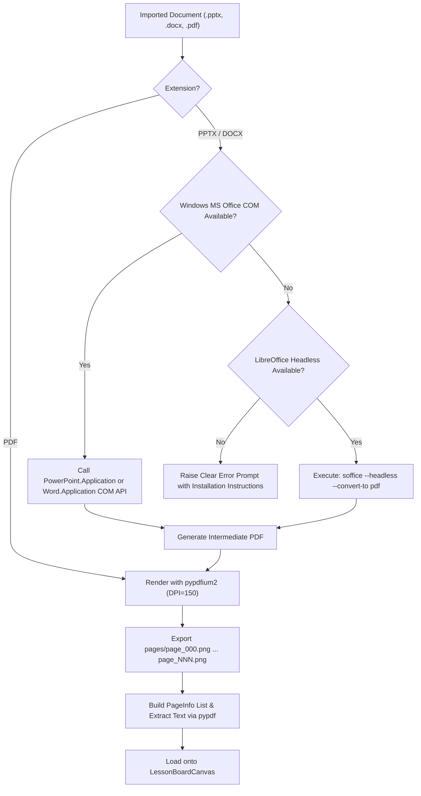

# AirTeach AI — Multi-Format Document Importer

**Component:** `src/services/document_manager.py`  
**Formats Supported:** `.pdf`, `.pptx`, `.docx`  
**Rendering Engine:** `pypdfium2` (PDFium) + `pypdf` + MS Office COM / LibreOffice Headless

---

## 1. Dual Conversion Strategy (Windows Office COM / LibreOffice)

To guarantee that teachers' presentation slides and lecture notes preserve 100% of their fonts, math formatting, and image layouts, AirTeach AI deploys an automated dual-conversion strategy:

---

## 2. PDF Rendering Precision

- **Resolution:** 150 DPI (equivalent to $1920 \times 1080$ Full HD canvas for standard 16:9 widescreen presentations).
- **Text Extraction:** Uses `pypdf.PdfReader` to extract embedded text per page, allowing the Gemini AI Assistant and search features to read slide content without OCR.
- **Memory Efficiency:** Pages are rendered to disk (`data/work/<doc_id>/pages/page_XXX.png`) and lazy-loaded into Qt memory only as the teacher navigates between slides.
