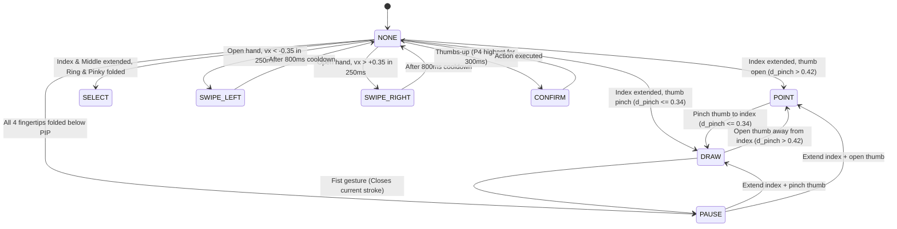

# AirTeach AI — Real-Time Hand Tracking & 6-Gesture Engine

**Component:** `src/core/hand_gesture_engine.py`  
**Tracking Model:** MediaPipe Tasks HandLandmarker (`models/hand_landmarker.task`)  
**Landmarks:** 21 3D Landmarks ($P_0$ through $P_{20}$)  
**Normalizer Metric:** Hand Base Distance $L_{\text{hand}} = \|P_0 - P_9\|$

---

## 1. 21 Hand Landmarks & The Normalization Standard

To eliminate dependency on the teacher's distance from the webcam (which varies from 0.5m to 2.5m in a classroom), all Euclidean distances between fingertip joints are divided by the anatomical scale factor:

$$L_{\text{hand}} = \sqrt{(x_9 - x_0)^2 + (y_9 - y_0)^2 + (z_9 - z_0)^2}$$

Where:
- $P_0$: Wrist root (`LM.WRIST`)
- $P_9$: Middle finger MCP joint (`LM.MIDDLE_MCP`)

```
          P8 (Index Tip)        P12 (Middle Tip)
             \                     /
            P7 (DIP)              P11 (DIP)
             |                     |
            P6 (PIP)              P10 (PIP)
             |                     |
            P5 (MCP)              P9 (MCP)  <--- Anchor for L_hand
               \                 /
      P4 (Thumb Tip)            /
        \                      /
        P3 (IP)               /
         \                   /
         P2 (MCP)           /
           \               /
            \             /
             P0 (WRIST)  <---------------------- Anchor for L_hand
```

---

## 2. 6-Gesture Finite State Machine (FSM)



### Formal Geometric Trigger Table

| Gesture | State | Geometric Conditions | Action & UI Response |
|---|---|---|---|
| ☝ **Index Extended, Thumb Pinched** | `DRAW` | $y_8 < y_6$ (Index up), $d_{\text{pinch}} = \frac{\|P_4 - P_6\|}{L_{\text{hand}}} \le 0.34$ | **Virtual Pen Down:** Emits stroke coordinates $(x_8, y_8, t_{\text{ms}})$ to canvas |
| ☝ **Index Extended, Thumb Open (L-shape)** | `POINT` | $y_8 < y_6$, $d_{\text{pinch}} > 0.42$ | **Laser Pointer:** Moves red laser spot on slide with zero ink generation |
| ✊ **Closed Fist** | `PAUSE` | $y_8 > y_6$, $y_{12} > y_{10}$, $y_{16} > y_{14}$, $y_{20} > y_{18}$ | **Pen Up / Commit:** Finalizes stroke, triggers 3-stage beautifier |
| ✌ **Two Fingers (V-Sign)** | `SELECT` | $y_8 < y_6$, $y_{12} < y_{10}$, $y_{16} > y_{14}$, $y_{20} > y_{18}$ | **Region Selection:** Draws selection box around ink strokes |
| 👋 **Open Hand Horizontal Swipe** | `SWIPE_LEFT`<br>`SWIPE_RIGHT` | All 5 fingers extended, $\|v_x\| > 0.35$ within 250ms window | **Slide Navigation:** Transitions to next or previous slide (800ms cooldown) |
| 👍 **Thumbs Up** | `CONFIRM` | $y_4$ is topmost landmark ($y_4 < y_i \ \forall i \neq 4$) held for $\ge 300\,\text{ms}$ | **Quick Confirmation:** Accepts shape snapping or LaTeX OCR candidate |

---

## 3. Anti-Jitter Debounce & False-Positive Prevention

1. **Confidence Threshold:** MediaPipe landmark tracking confidence must be $\ge 0.75$.
2. **Debounce Counter:** State transitions require $\ge 3$ consecutive frames agreeing on the new gesture before switching.
3. **Pinch Hysteresis:**
   - Entering `DRAW` requires $d_{\text{pinch}} \le 0.34$.
   - Leaving `DRAW` to `POINT` requires $d_{\text{pinch}} > 0.42$.
   - This $0.08\,L_{\text{hand}}$ deadband prevents erratic stroke interruptions.
4. **Tracking Disconnect Safeguard:** If hand leaves camera frame during drawing, the stroke terminates gracefully rather than connecting the old point to random screen boundaries.
